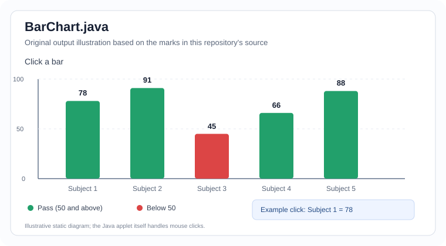

# Java Lab — Case Study Index

This index connects the applied problems to their implementation in the experiment folders. It is intentionally written as a practical lab companion, not as a replacement for the faculty's prescribed problem statements.

## Existing case-study programs

| Case study / application | Experiment | Source file | Concepts demonstrated |
|---|---|---|---|
| Mess bill and total collection | 01 | [MessBill.java](../Experiment-01/MessBill.java) | Classes, objects, arrays, methods, formatted output |
| Course fee calculation | 02 | [FeeApp.java](../Experiment-02/FeeApp.java) | Packages, modular design, methods |
| Payment charges for UPI, card, and cash | 03 | [PaymentDemo.java](../Experiment-03/PaymentDemo.java) | Interface, polymorphism, method overriding |
| Salary slip for employee types | 04 | [SalarySlip.java](../Experiment-04/SalarySlip.java) | Abstract class, inheritance, method overriding |
| Multi-counter ticket booking | 05 | [Booking.java](../Experiment-05/Booking.java) | Threads, synchronized method, shared state |
| ATM withdrawal validation | 06 | [Atm.java](../Experiment-06/Atm.java) | User-defined exceptions, validation, exception handling |
| Student result report | 07 | [ResultReport.java](../Experiment-07/ResultReport.java) | File input/output, parsing, aggregation |
| Interactive marks bar chart | 08 | [BarChart.java](../Experiment-08/BarChart.java) and [BarChart-Output.svg](../Experiment-08/BarChart-Output.svg) | Java applet graphics, `paint()`, mouse events, conditional bar colors |

### Experiment 08 — BarChart case study

`BarChart.java` draws five subject-mark bars using the values defined in the source. Bars for marks of 50 or more are green; the bar below 50 is red. Clicking a bar updates the message to show that subject's mark.

The SVG above is an original diagram created for this repository from the values and behavior in `BarChart.java`; it is not copied from the reference repository. It is a static illustration, not a screenshot of a running applet. Capture a real screenshot from your lab environment if your faculty specifically requires runtime evidence.
| Student registration form | 09 | [RegisterForm.java](../Experiment-09/RegisterForm.java) | Swing components, event handling, input validation |
| Student database operations | 10 | [StudentApp.java](../Experiment-10/StudentApp.java) and [database.sql](../Experiment-10/database.sql) | JDBC, prepared statements, SQL |

## Case-study write-up template

For each case study required by the lab manual, include these sections in your record or report:

1. **Problem statement** — what the application must solve.
2. **Objective** — the Java concept being demonstrated.
3. **Algorithm / procedure** — the main steps in order.
4. **Source code** — the relevant program(s).
5. **Test data** — normal input plus at least one boundary or invalid case where relevant.
6. **Output** — actual output captured from a successful run; for GUI programs, a screenshot.
7. **Result** — one or two sentences stating what was verified.
8. **Viva points** — explain the Java concepts used and why.

## Completion checklist

- [ ] Confirm each required case study against the faculty's lab manual.
- [ ] State the scenario and objective in your own words.
- [ ] Include algorithm/steps where the record format requires them.
- [ ] Test normal, boundary, and invalid inputs where applicable.
- [ ] Attach real output or screenshots; do not claim an output was observed unless you ran it.
- [ ] For concurrency examples, explain that thread output order can vary between runs.
- [ ] For file examples, include the required input file and the expected generated file.
- [ ] For JDBC, include schema/setup SQL and explain the connection configuration.
- [ ] Add any faculty-prescribed case study not covered by the programs listed above.
